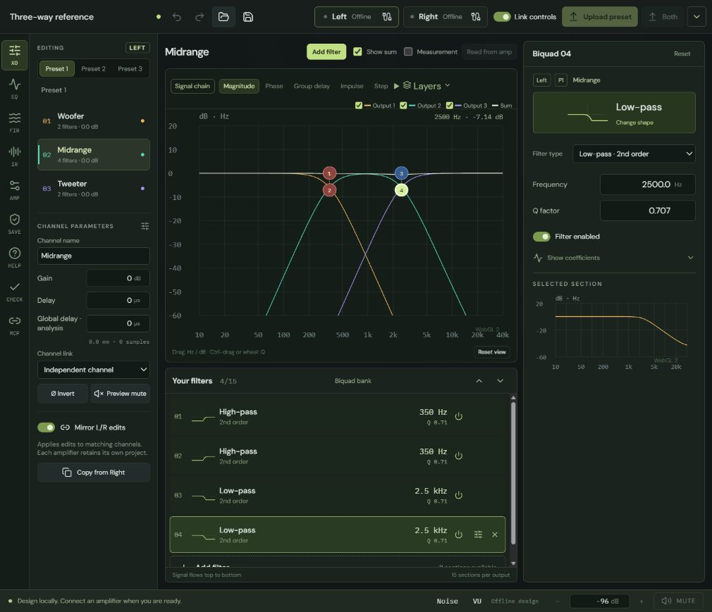

# Fusion Studio

Fusion Studio is a web implementation of the Hypex Filter Design Windows app’s functionality, with an MCP server.

Design crossovers, inspect measurements and manage Hypex FA503 amplifier settings in a browser. Left and Right have independent projects and device identities, with shared controls where appropriate. The interface and agents use the same application services.



_Filter editor with a persistent parameter inspector._

This is an independent project. Software implementation and simulation coverage do not establish complete HFD compatibility or qualify every hardware operation. Current live protocol support targets FA503 / DSP3-213 core 5.1. Other device families, macOS USB behavior and simultaneous operation of two physical amplifiers remain unqualified.

## Start locally

Use Node.js 22.13 or newer and pnpm 11.25.0. Development has used Node.js 24.

```sh
pnpm install
pnpm dev
```

Open [the local application](http://127.0.0.1:3210) in desktop Chrome or Edge. Windows Chromium browsers are the development target; recorded browser acceptance primarily uses Chrome. A secure browser context and an explicit browser device grant are required for WebHID. Close other software that owns the same amplifier USB interface before connecting.

The app works offline for design tasks. No amplifier or agent connection is needed to create filters, import measurements or inspect responses.

Firmware file staging, fixed-target review, exact-review confirmation, outcomes and recovery history now share one UI/MCP controller. The real WebHID adapter has queued transition and stream fences, durable known-range before-images and explicit journal-based recovery; its source-owned physical qualification registry remains empty, so physical firmware programming is unavailable. Neither a staged-file match nor a reported runtime version grants programming permission. See [firmware workflow](docs/FIRMWARE-WORKFLOW-v44.md).

Ordinary crossover marker dragging now uses absolute graph frequency with Single storage. A vertical move applies its cumulative axis delta to each role's own captured gain, using the native Extended-arithmetic and bounded two-decimal Double path; Peak and shelves cap at 24 dB, and inactive gain/F2 fields stay untouched. It does not acquire the separate field-wheel AdditionalGain ceiling. Canonical no-ops retain caches and history. A later independent edit commits pending drag work first, so a stale cancel cannot erase it. See [graph drag scope](docs/GRAPH-DRAG-v45.md).

Conditional **Hardware gain compensation** now shares one channel-edit planner between the inspector and the existing MCP command. It edits project compensation and the native document hint; it sends no amplifier command. Off sets the selected compensation to 0, while On sets it to 10 and can cap coupled channel Gain at 14 dB under the recovered factory profile. All selected roles validate before one paired Undo, canonical no-ops retain history, and metadata-only edits preserve linked follower caches. Actual processing changes propagate only through the edited root's group in its preset. See [hardware gain and channel-edit scope](docs/HARDWARE-GAIN-v46.md).

Focused numeric editing now uses owned field leases. The shared workspace protects accepted independent edits, including graph and MCP writeback: it commits pending local work only after validation, before the independent edit's own Undo step. A stale Escape cannot restore an older baseline over that edit. Refused proposals and canonical no-ops leave the current local edit intact; stale drafts and wheel state renew from the current value when editing resumes. The registry remains 91 commands. See [numeric transaction scope](docs/NUMERIC-TRANSACTIONS-v47.md).

Offline channel Gain now uses the native FA503 field profile: passive Single presentation, original raw Text committed to a two-decimal Double, factory bounds -125..24 dB and one signed 0.1 dB wheel event. Each role applies its own AdditionalGain ceiling before publication; linked typed edits keep the original request for both roles, and source-basis wheels mirror only a changed canonical source result. Normal inspector editing and the existing 91-command MCP surface share these rules and Undo boundaries. The V48 public checks passed **3,286 tests plus the sole optional exact PDF skip: 3,287 total in 214 files**, with TypeScript, Next and Worker packaging passed; private coverage is **3,287 canonical tests plus 108 included diagnostic assertions**. The export contains 434 source plus 13 protected files, 447 total. Native offline saved-file checks cover the ordinary profile; browser, connected MCP, physical amplifier and full-platform qualifications remain open. See [channel Gain scope](docs/CHANNEL-GAIN-v48.md).

## What is implemented

- Three presets, three output channels and fifteen biquad slots per channel; low/high-pass, shelves, asymmetric shelves, peak, all-pass, unity and explicit raw coefficients.
- A compact graph editor with a persistent parameter inspector, advanced signal-chain editing, channel links, gain, delay, polarity and response sums.
- Nine-band input EQ, independent live EQ activation, three-bank transfer and explicit EQ upload.
- Input/output FIR placement, text coefficient import, retained bypass state and original-data exports.
- Impulse, Step, Magnitude and Phase views; measurement import, window/crop controls, selected-reference Fit truncated bounds, smoothing, project microphone correction and optional browser audio capture.
- Role-aware device settings, shared amplifier-mode reviews, limiter editing, device defaults, Device templates, diagnostics and recovery journals.
- A conditional native OEM digital User mixer with independent per-preset Left/Right drafts, quantized previews, explicit coordinated Save and retained operation records.
- Browser project persistence, a project library, granted-directory Open/Save, reviewed recovery and bounded large-file transfers.
- A shared Native Save artifact for JSON, native folders and ZIPs, with fresh read-only physical settings/EQ capture for supported connected targets and an explicit Design only option.
- Offline firmware file inspection and explicit runtime identity reports for known 5.7/core 5.1 and 5.82/core 5.5 profiles. File recognition does not prove the installed image; core 5.5 remains diagnostic-only and production firmware programming is unavailable.
- A local MCP server and optional authenticated hosted bridge. The current registry exposes **91 commands**; the running server’s `tools/list` is authoritative.

Magnitude graph Q gestures now use the native selected-section behavior: wheel input anywhere in the chart applies one signed 0.04 step to the already-selected section, and Ctrl-drag captures Ctrl at drag start and applies one step per qualifying vertical move. LP2, HP2, Shelf2 and Peak support graph Q; Asymmetric and AP2 retain their separate numeric Q controls. Whole-channel response display does not remove the editing selection. Ordinary graph Q explicitly reparses its final three-decimal Text to Double, including an off-grid bound whose visible Text does not change. Input EQ graph editing remains a browser convenience using its separate field-publication profile.

Imported native Unknown shelf direction now follows its type-specific branch: ordinary Shelf1/Shelf2 use Low, while Asymmetric uses its distinct High branch. The raw native direction enum survives ordinary parameter and bypass edits; an explicit direction choice records the corresponding Low/High enum even when it matches Unknown's effective direction. Contradictory type/direction choices are rejected, and legacy filters without this metadata do not acquire an invented enum. Untouched caches remain retained.

Ordinary preset FIR transfer sends only the selected input or output placement. Effective graph FIRs in the inactive placement remain in the project. A compact, initially collapsed disclosure keeps the advisory count, transfer meaning and role/preset scope visible; all detailed warnings remain available in a bounded scroll area. Channel controls retain their compact editing context. No extra hardware write is implied by these software changes.

Manual crossover frequency text commits on Enter or blur, using HFD's one-decimal conversion and Single storage. Ordinary edits use 10–50,000 Hz; incomplete drafts stay local, and typing zero retains the previous value. Imported and untouched parameters retain their original precision. Changing shape preserves bypass, including each role's independent Enabled state during linked replacement. Preview Add/Replace still uses an explicit Apply action.

Ordinary crossover Q1/Q2 and BQ gain now share native raw-text commits in the inspector, palette and MCP. Recovered FA503 defaults are Q 0.1–20 with three decimals and gain −125…24 dB with two decimals; both store Double. Zero retains the previous Q, while gain zero is accepted. Passive display leaves imported values untouched. Native nonfinite caches remain rejected, and extreme filters that fail coefficient stability checks remain unprogrammable. See [verification](docs/VERIFICATION.md).

Ordinary output Q1/Q2 and BQ-gain wheel edits now follow the native factory steps: 0.04 for Q and 0.1 dB for gain per delivered event, using its direction rather than multiplying by wheel magnitude. Inspector wheels update the design directly; palette wheels remain in the local preview until Apply. An unchanged formatted value preserves exact imported values and caches. AdditionalGain can cap the visible field while the stored BQ gain is higher; an adjacent **Stored … dB** detail exposes the value used for analysis, compilation and export. Continuous wheel state is local to that field. [MCP wheel adjustments](docs/MCP.md#ordinary-parameter-wheel-adjustments) are stateless events; keyboard increments, frequency wheels and graph gestures keep their separate contracts. Exact native cached coefficients also survive base/custom-cache classification without a one-ULP reconstruction loss.

Remove/Delete keeps a section's slot identity, Enabled flag and latent parameters while making its transfer Unity. The broader Reset remains separate, and Add can reuse an enabled Unity slot. A valid fresh native zero-gain Peak cache is accepted when the gain multiplier is exactly one, while nonunit and inverted-cache ambiguity guards remain. See [verification](docs/VERIFICATION.md) for the bounded acceptance and remaining limits.

The v36 development checkpoint compares four actual offline HFD manual-filter states—low/high asymmetric shelves and a high Shelf2 at ±6 dB—using saved coefficients and independent screenshot measurements. It also corrects filter-point positions to follow each section's own unbypassed response. Actual Studio marker and typed-edit checks passed for those fixed states; this is bounded software acceptance, not complete native or hardware parity. See [verification](docs/VERIFICATION.md).

Filter and measurement edits update the design directly. Validated numeric settings commit on Enter or blur where appropriate. Consequential changes use adjacent **Apply**, **Save**, **Update** or **Upload** actions. The developer command console is optional; normal editing never requires a generic Run command.

## Preserve your work

Workspace data lives in this browser origin’s IndexedDB storage. A different hostname, port, browser profile or hosted origin has different data and grants. Export project JSON, native project folders and recovery files before changing origin, clearing browser data or moving computers. A project Save is distinct from a hardware Upload.

Directory saves preserve unrelated files and keep verified before-images, but a multi-file directory save is not an atomic filesystem transaction. An unconfirmed hardware result is also not proof that nothing changed. Inspect its ledger before proceeding.

Opening Save stages a fixed role, design revision and initial device session without I/O. In Auto mode, the first resolve reads matched physical settings and all three EQ banks for an initially connected commercial FA503; it does not send setters or replace staged design EQ. JSON downloads and native folder/ZIP saves use that detached artifact. Design only and initially offline exports preserve the frozen design, including downloads after later edits. A failed connected capture needs an explicit retry with a new capture ID or a Design only choice; it never silently substitutes old metadata.

Save artifacts last for this page lifetime and are bounded to eight IDs, 80 million retained text characters and 640 MB across projects/files. Prepared directory journals durably retain their own exact bytes, so their replay and filesystem commit do not recapture hardware. One actual FA503 on firmware 5.7/core 5.1 completed read-only capture through the Save UI and MCP, with hash-verified JSON bytes delivered through a file-transfer chunk. Both workspace projects and selection remained unchanged, and no amplifier setter was sent. Browser download delivery and paired physical capture remain unverified. A separate v35 offline native HFD graph comparison now supports the tested phase, visibility, shared-crop and Fit truncated behavior; it does not establish complete HFD equivalence. See [verification](docs/VERIFICATION.md).

## Use an MCP client

Keep the app running and start the local server in a second terminal:

```sh
pnpm mcp
```

The server prints a loopback MCP URL, a WebSocket bridge URL and a newly generated pairing token. In **Agent access**, connect to `ws://127.0.0.1:3211/bridge` using that token. Configure your MCP client with `http://127.0.0.1:3211/mcp` and `Authorization: Bearer <pairing token>`. Treat the token as a credential: a paired agent can issue application commands, including permitted device writes.

See [MCP setup and workflow guidance](docs/MCP.md).

## Checks and build

V46 public checks passed **3,167 tests plus the sole optional-PDF skip: 3,168 total in 208 files**, TypeScript, Next production build and Worker packaging. Private checks passed **3,168 canonical product tests** plus **108 included ignored diagnostic assertions**. The registry remains **91 commands**; the reviewed export has **425 source plus 13 protected files, 438 total**. Five offline native Saves include three isolated edit oracles and one combined navigation state; the combined extra microphone-correction change is not an isolated compensation side effect. Eleven paired Node integration checks passed against the actual owned HTTP/WebSocket server and a Node fixture client using the production authority/store/shared executor; this does not qualify the production client, Studio/browser or physical amplifiers. A dated connected catalog matched all 91 names but lacked the newer hardware-gain/graph-drag declarations, with cause unestablished. See [V46 qualifications](docs/VERIFICATION.md#v46-hardware-gain-and-channel-edit-checkpoint).

V45 public checks passed **3,085 tests plus the sole optional-PDF skip: 3,086 total in 203 files**, TypeScript, Next production build and Worker packaging. Private checks passed **3,086 canonical product tests** plus **108 included ignored diagnostic assertions**. The registry remains **91 commands**; the reviewed export has **417 source plus 13 protected files, 430 total**. Four bounded offline native filter cases were accepted; two unaccepted upper input requests and a background pan remain separately recorded. The owned local HTTP MCP protocol passed ten unpaired checks; one isolated browser baseline was accepted with three setup interruptions retained. Graph-drag and paired browser execution were not accepted. Native runtime Settings were not captured before the session, so no complete before/after Settings preservation claim follows. See [V45 qualifications](docs/VERIFICATION.md#v45-ordinary-graph-drag-checkpoint).

V44 public checks passed **3,012 tests plus the sole optional-PDF skip: 3,013 total in 197 files**, TypeScript, Next production build and Worker packaging. The private suite passed **3,013 canonical product tests** plus **108 included ignored diagnostic assertions**. The registry remains **91 commands** and the reviewed export has **408 source plus 13 protected files, 421 total**. This increment adds automated workflow/transport checks and **10/10 owned local HTTP protocol checks**. One isolated synthetic browser baseline was accepted, with two pairing interruptions retained; paired browser execution and a completed firmware UI workflow were not verified. No remote/production MCP or physical-firmware acceptance is claimed. See the [V44 qualification checkpoint](docs/VERIFICATION.md#v44-firmware-workflow-checkpoint).

V43 public checks passed **2,933 tests plus the sole optional-PDF skip: 2,934 total in 194 files**, TypeScript, Next production build and Worker packaging. Development coverage passed **2,934 canonical tests**; the full private run additionally includes **108 local diagnostic assertions**. Final isolated UI verification recorded **36 accepted checks and 1 retained unaccepted setup check**; the earlier iteration retains **4 accepted checks and one corrected layout failure**. The registry has **91 commands** and the reviewed export has **414 files**. Detailed native observations, retained verification failures and remaining hardware, firmware, macOS, two-amplifier and remote MCP qualification are documented in [verification](docs/VERIFICATION.md#v43-graph-q-and-fir-checkpoint).

V42 development-source verification passed **2,806/2,806 tests in 188 files**. The public checkout passed **2,805 tests plus the sole optional-PDF skip: 2,806 total in 188 files**, typecheck, Next production build and Worker packaging. Both suites used two workers, no test filters or changed timeouts, and unchanged source snapshots. Actual isolated Studio work recorded **45 accepted browser checks and two retained initial unaccepted assertions** among 47 observed attempts. The immediate graph-footer heading assertion was corrected by subsequent DOM and later footer observations. A fast leading-dot commit initially appeared unchanged; its cause remains unproven. Observed-draft commits, three repeated wheel/Undo/leading-dot sequences and five separate JSDOM diagnostics passed. No product defect was reproduced, but JSDOM does not adjudicate the browser observation and its timing qualification remains open. Input EQ now uses its recovered Double parameter profile and separate wheels; unchanged mirrored peers retain their exact coefficient caches. Five completed offline native saves separately qualify channel gain/inversion/cache observations. The registry contains **91 commands**, and the reviewed export has **392 source plus 13 protected public files: 405 total**. Native EQ popup, passive-selection and Default acceptance remain open. See [verification](docs/VERIFICATION.md#v42-input-eq-parameter-checkpoint).

V41 development-source verification passed **2,742/2,742 tests in 186 files**; the public checkout passed **2,741 tests plus the sole optional-PDF skip, 2,742 total in 186 files**. Both runs used two workers, no test filters or changed timeouts, with unchanged source snapshots and passing typecheck. The public Next production build and Worker packaging passed. Actual Studio acceptance passed **29/29 Chrome checks** against synthetic designs with blocked external I/O; all five raw fields were visible at 1024×768 without document scrolling. The reviewed public export contains **387 source files plus 13 protected public files: 400 total**. Private deployment succeeded with MCP enabled and owner-only access preserved. See [verification](docs/VERIFICATION.md#v41-raw-coefficient-checkpoint).

V40 development-source checks passed **2,691/2,691 tests across 185 files**, with zero failures or pending tests, two workers, unchanged timeouts and all 377 source/test/configuration hashes plus the recorded `.gitignore` unchanged. Actual Studio acceptance passed **29/29 browser checks** in Chrome using genuine tab-scoped wheel input and the shared command console; no blocked I/O attempts were recorded and the 160 bundled product source files stayed unchanged. Native evidence comprises 22 actual HFD saves and a separately labeled synthetic input. Private V40 deployment succeeded with MCP enabled and unchanged owner-only access. Fresh V40 public-checkout checks passed **2,690 passed plus the sole optional-PDF skip: 2,691 total across 185 files**; global typecheck, Next production build and Worker packaging passed. The reviewed export has **385 source files plus 13 protected public files: 398 total**. The V39 results below remain historical evidence. See [verification](docs/VERIFICATION.md#v40-ordinary-parameter-wheel-checkpoint) for the bounded scope.

V39 development-source checks passed **2,627/2,627 tests across 183 files**, with zero failures or pending tests, two workers, unchanged timeouts and an unchanged 373-file source snapshot. Global typecheck and formatting passed. Actual Studio acceptance recorded **38 accepted browser checks**, with one obstructed initial QA assertion retained separately and the corrected command/Undo checks passing. The public checkout passed **2,626 tests plus the sole optional-PDF skip: 2,627 total in 183 files**, typecheck, Next production build and Worker packaging. The private deployment succeeded with MCP enabled and unchanged owner-only access. The V38 results below remain historical evidence.

V38 development-source checks passed **2,560 tests in 181 files**, with zero failures, two workers, unchanged timeouts, global typecheck and formatting passing. Actual Studio acceptance passed **31 bounded browser checks**, covering committed frequency precision, retained bypass, paired shape changes, Undo, imported values and reload. The fresh public checkout passed **2,559 tests plus one optional-PDF skip: 2,560 total in 181 files**, typecheck, Next production build and Worker packaging. The private deployment succeeded with MCP enabled and unchanged owner-only access. See [verification](docs/VERIFICATION.md) for exact scope and retained test corrections.

```sh
pnpm typecheck
pnpm test
pnpm build
```

V37 development-source checks passed **2,507 tests in 179 files**, with two workers, unchanged timeouts, global typecheck and formatting passing. Actual Studio browser acceptance passed **19 checks** covering Delete/Add identity reuse, Undo, bypass/re-enable, independent Both edits and reload persistence. The first full run exposed eight outdated positional marker-test oracles; a test-only correction preceded the passing full rerun. The fresh public checkout passed **2,506 tests plus one optional-PDF skip: 2,507 total across 179 files**, with zero failures, two workers and unchanged timeouts; typecheck, Next production build and Worker packaging passed. Private deployment succeeded with MCP enabled and unchanged owner-only access; no public hosted deployment is claimed. See [verification](docs/VERIFICATION.md) for the bounded evidence and limits.

The prior v36 public checkout passed **2,482 tests plus one optional-PDF skip: 2,483 total across 178 files**, with zero failures, two workers, unchanged timeouts, typecheck, Next production build and Worker packaging passing. The development-source suite also passed all 2,483 tests. See [verification](docs/VERIFICATION.md) for exact build results and native/browser acceptance limits. These are public-source checks; no public hosted deployment is claimed.

The prior v35 public checkout passed **2,464 tests plus one optional-PDF skip: 2,465 total across 178 files**, with two workers, unchanged timeouts, typecheck and production builds passing. V35 corrects selected-reference floating-grid Fit truncated bounds, supported by independent native graph comparisons and actual Studio/MCP browser checks. These checks qualify the tested behavior, not complete HFD or hardware parity. The development-source first full run had one timeout; that test passed in isolation and the full rerun passed. See [verification](docs/VERIFICATION.md) for exact results, historical v34 numbers and remaining limits.

The build produces the static application in `out/` and a packaged optional hosted Worker in `dist/server/index.js`. Hosted authentication, database and object-storage bindings require separate deployment configuration. The local app and local MCP server do not require that hosting platform.

The public source does not include vendor executables, firmware bundles or a vendor manual PDF. Help uses official vendor links when the optional local manual is absent.

## Documentation

- [Getting started](docs/GETTING_STARTED.md)
- [Architecture and persistence](docs/ARCHITECTURE.md)
- [MCP server](docs/MCP.md)
- [Explicit coefficient editing and cache interpretation](docs/HFD-RAW-COEFFICIENT-EDITOR.md)
- [USB protocol and operation boundaries](docs/USB_PROTOCOL.md)
- [Native digital User mixer](docs/NATIVE_MIXER.md)
- [Firmware files and read-only runtime identity](docs/FIRMWARE_RUNTIME.md)
- [Verification and remaining qualification](docs/VERIFICATION.md)
- [Contributing](CONTRIBUTING.md)
- [Security](SECURITY.md)
- [Third-party notices](THIRD_PARTY_NOTICES.md)

## License

Original project code and documentation are available under the [MIT License](LICENSE), copyright 2026 manuaero. Third-party dependencies and vendor materials retain their own terms and are not relicensed by this project. See [third-party notices](THIRD_PARTY_NOTICES.md).
