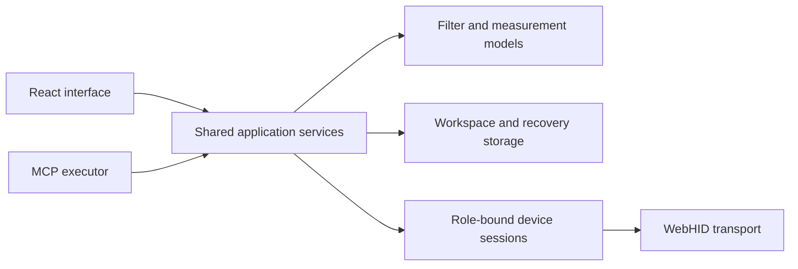

# Architecture

Fusion Studio separates numerical models, application workflows, browser adapters and hardware transactions. The human interface and MCP executor call the same application services so draft state, reviews and outcomes remain visible across entry points.

## Stack

Versions are pinned in `package.json` and `pnpm-lock.yaml`.

| Area                 | Packages                                                   |
| -------------------- | ---------------------------------------------------------- |
| UI and application   | Next.js 16.4.6, React/React DOM 19.3.1, TypeScript 7.0.2   |
| State and validation | Zustand 5.1.0, Zod 4.6.7                                   |
| Browser persistence  | IndexedDB through idb 8.0.4                                |
| Agent integration    | use-webmcp-tool 0.3.0, WebSocket support through ws 8.23.0 |
| UI assets            | lucide-react 1.72.0; optional externally served fonts      |
| Tests/build tools    | Vitest 5.1.0, jsdom 31.0.0, esbuild 0.28.2, pnpm 11.25.0   |

Response plots use browser rendering and bounded numerical data. WebGL is not required by the current architecture.

## Source boundaries

- `src/domain/`: projects, filter math, measurement processing, time/frequency analysis and import/export formats.
- `src/application/`: shared controllers, tool schemas, fixed-target workflows, file transfers, source/directory operations and operation journals.
- `src/state/`: workspace state, Undo/Redo and durable persistence.
- `src/hardware/`: codecs, permission rules, device plans, serialized sessions, transport and a test-only simulated panel.
- `src/audio/` and `public/audio/`: browser capture backend and worklet.
- `src/components/`: presentation and browser input adapters.
- `server/mcp.ts`: optional authenticated loopback MCP/WebSocket bridge.
- `server/site/`: optional hosted transport/static-asset implementation.

An editable crossover design is distinct from a captured physical Device template. Physical settings and three EQ banks retain their provenance instead of silently becoming the staged design EQ. Draft Device template overrides are excluded from captured-template export.

## State, history and durable commits

The workspace has independent Left/Right projects, a selection and a monotonic document revision. Hydration gates edits. Asynchronous imports bind their role, preset, channel and expected revision before awaiting a picker, read or analysis. They cannot retarget themselves to a later selection.

Workspace changes and import receipts persist together. An exact receipt replay does not repeat the import, including after Undo. Save failures expose recovery rather than presenting volatile memory as saved. Project libraries, file-transfer chunks and operation recovery journals use separate bounded stores.

Device workflows reserve the relevant sessions and distinguish read-only preflight, durable preparation, actual transmission and verified outcome. Two-device operations preflight all intended targets before the first setter where their contract requires it. A partial ledger describes each role independently; USB writes are not a cross-device atomic transaction.

## Persistent authority

A random browser-owned workspace identity persists in IndexedDB. New human UI, manual, WebMCP and admitted paired-client operations share that workspace owner, with distinct scopes. The existing explicit pairing/Enable action grants an authenticated client application access; a tool argument cannot invent its owner.

Revocation stops new admissions. Already admitted operations may finish and retain their results. Directory journals from an older ownership scheme require an explicit local-human adoption review. Their original owner, request ID, before-images and receipts remain intact. Older non-directory transfer/source/capture receipts are not universally migrated.

Browser ownership is an application boundary, not encryption against other scripts running in the same origin. See [security](../SECURITY.md).

## Filesystem adaptation

Source Open reads fresh data from a granted directory. Directory Save creates an immutable reviewed export, materializes independent before-image bytes and durably verifies its journal before overwriting files. It preserves unknown files and verifies each completed file.

Same-origin Web Locks and fresh journal compare-and-swap coordinate this application’s writers. They do not lock HFD or another operating-system process. A pre-close comparison narrows the external-edit window, but there is no filesystem-wide compare-and-swap or atomic multi-file commit.

## Audio and transport

Browser capture uses explicit device routing and actual runtime sample-rate information. Stream/context teardown, cancellation and retained-result conflicts belong to one shared controller. Audio capture is separate from amplifier USB control.

WebHID uses one pending request per interface. A timeout or unexpected response faults the session so a delayed reply cannot satisfy a later request. Recovery requires inspection and a fresh connection; generic blind retries are not a safe substitute.

## Optional hosted bridge

The hosted implementation authenticates owners and binds commands to a browser lease. Queue payloads/results use ephemeral authenticated encryption in object storage. The HTTPS Worker still processes plaintext to execute the protocol; this is not end-to-end encryption. Browser workspace storage and hosted queue/database resources are separate systems.

No hosted account, private deployment identifier or service credential is required for local development. Deployment bindings and authentication must be configured for an operator’s own environment.
