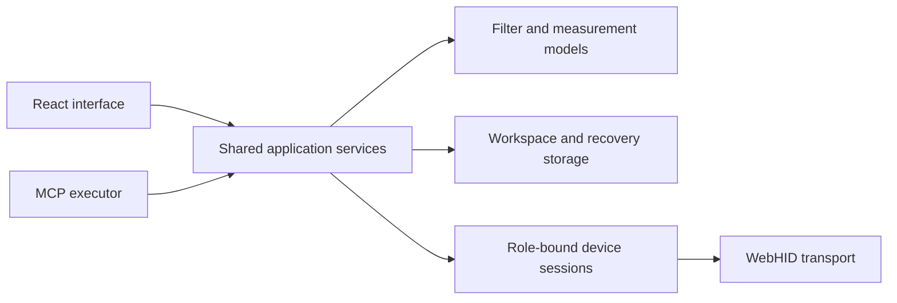

# Architecture

Fusion Studio separates numerical models, application workflows, browser adapters and hardware transactions. The human interface and MCP executor call the same application services so draft state, reviews and outcomes remain visible across entry points.

## V51 native File Open preparation

Native Open is an explicit application workflow, distinct from parsing and workspace hydration. Trusted decoding supplies internal `ProjectReplacementIntent`: `native-file-open` with `dialog` or `inner`, or snapshot/new-project semantics. A project's embedded `sourceXml` cannot grant that intent. Native XML and native-only uploaded folders use `dialog`; fresh native saved-directory reads use `inner`. Browser recent-source policy does not assert a proved native MRU callback identity.

`application/native-project-open.ts` accepts each role's runtime preset from the trusted caller: offline preset 1, or a validated cached preset of its assigned panel session. It never chooses runtime selection from XML or Clone metadata and performs no USB read. Optional native `hfdSelectedPreset` is separate from Clone settings; Open writes the chosen preset while retaining `hfdSelectedGroupId`. Group -1 selects the first channel, groups 1..3 map directly, and absent/unmapped values produce no Graph selection.

The `dialog` plan rebinds microphone application across the chosen preset, independently of microphone Loaded. The selected cold Graph owns its final flag: false only for explicit project calibration `loaded:false`, otherwise true after dialog bind/refresh. The `inner` route omits the post-open loop and keeps ordinary known-unloaded constructor clearing. Shared constructor logic normalizes admitted compensation and independent Gain while retaining the linked Gain-store guard. Automatic Open does not rewrite the saved group as an explicit channel-navigation action would.

Preparation stages document metadata, cold constructor fields, selected measured-response availability and reconciled native measurement caches on a detached proposal. Every requested role validates before one authoritative replacement and any durable receipt; failed preparation leaves all targets unchanged. The post-hook accepts only the matching generation/revision/final data and claims visits/views without another model edit. Undo and replay restore data without rerunning Native Open. Snapshot replacement remains separate and retains ordinary visible-Graph behavior.

No broad link synchronization is performed. Imported filters, identities, provenance and cache interpretation remain intact; the observed native linked-load source-copy scope remains an explicit gap. Sink-ID regeneration is also neither reproduced nor declared harmless. This service adds no amplifier or bridge-configuration operation.

## Stack

Versions are pinned in `package.json` and `pnpm-lock.yaml`.

| Area                 | Packages                                                   |
| -------------------- | ---------------------------------------------------------- |
| UI and application   | Next.js 16.4.6, React/React DOM 19.3.1, TypeScript 7.0.2   |
| State and validation | Zustand 5.1.0, Zod 4.6.7                                   |
| Browser persistence  | IndexedDB through idb 8.0.4                                |
| Agent integration    | use-webmcp-tool 0.3.0, WebSocket support through ws 8.23.0 |
| UI assets            | lucide-react 1.72.0; optional externally served fonts      |
| Tests/build tools    | Vitest 5.1.0, jsdom 31.0.0, esbuild 0.28.2, pnpm 11.25.0   |

Response plots use browser rendering and bounded numerical data. WebGL is not required by the current architecture.

## Source boundaries

- `src/domain/`: projects, filter math, measurement processing, time/frequency analysis and import/export formats.
- `src/application/`: shared controllers, tool schemas, fixed-target workflows, file transfers, source/directory operations and operation journals.
- `src/state/`: workspace state, Undo/Redo and durable persistence.
- `src/hardware/`: codecs, permission rules, device plans, serialized sessions, transport and a test-only simulated panel.
- `src/audio/` and `public/audio/`: browser capture backend and worklet.
- `src/components/`: presentation and browser input adapters.
- `server/mcp.ts`: optional authenticated loopback MCP/WebSocket bridge.
- `server/site/`: optional hosted transport/static-asset implementation.

An editable crossover design is distinct from a captured physical Device template. Physical settings and three EQ banks retain their provenance instead of silently becoming the staged design EQ. Draft Device template overrides are excluded from captured-template export.

## Native Save capture

`application/native-project-save.ts` supplies one detached artifact to the Save dialog, explicit MCP save actions, chunked downloads and directory Prepare. Staging captures roles, document references/revision, sessions and identities synchronously without I/O. Auto resolution reads fresh physical metadata/EQ only for roles connected at staging; Design mode remains a pure frozen export.

The supported commercial FA503 capture reads matched snapshots of serialized settings, selected FIR filenames and the three physical EQ metadata pages. It does not read or substitute hardware IIR/FIR coefficient designs. Captured physical metadata goes into the detached project’s Device template while staged EQ stays unchanged. Explicit fresh-host defaults identify fields absent from the wire profile instead of borrowing unrelated Windows host state.

Connected roles use sorted session reservations, all-settled reads and final all-target/revision/session checks. A failing or replaced Right target cannot publish a Left artifact or update either workspace document. A successful artifact is immutable and cached; subsequent resolution is historical zero-I/O reuse. Initially offline/design-only exports preserve their staged JSON even after later design edits.

The controller retains at most eight IDs and budgets detached projects plus resolved file text against 80 million characters and 640 MB. Both roles count separately. Failures retain bounded summaries rather than large partial artifacts; release/dispose invalidates late work without closing a user-owned device. These artifacts are page-local and distinct from durable directory journals.

## Conditional native mixer

`hardware/native-mixer.ts` models capability reachability, exact raw Q8 rows,
explicit native row opening, typed Text formatting and Single/Q24 wire
quantization. Cached Session capability is for presentation only; final reads
and writes independently validate identity and native permissions. Commercial
module 9 does not expose an editable User mixer.

`application/native-mixer.ts` owns the same independent role/preset drafts,
revision, review and outcome for UI and MCP. A Save fixes its selected row,
retains the other physical rows exactly and reserves all participants. Durable
before-images and a common fresh barrier precede a single write/readback per
changed role. Strict CAS journals retain original reports, desired bytes and
attempt outcomes. Consumed replay is zero-I/O; no automatic retry, rollback or
manufacturing enable setter is provided. Human record download and agent
chunked export expose the same retained journal. See the
[native mixer workflow](NATIVE_MIXER.md).

## Read-only firmware runtime identity

`domain/firmware-profile.ts` recognizes exact known source-file hashes separately
from runtime reports. `hardware/firmware-runtime-inspector.ts` performs eight
literal read requests and validates two matching metadata projections for the
known FA503 5.7/core 5.1 and 5.82/core 5.5 tuples. It cannot establish an installed
image hash, descriptor family or setter capability.

`application/firmware-runtime-source.ts` captures exact HID object/session
ownership without choosing or enumerating devices. The shared
`application/firmware-runtime.ts` controller owns role/owner/source fences,
staleness, explicit Read/Clear and paired publication. Normal core 5.5 admission
stays blocked: Connect can diagnose the chosen interface read-only, close it and
retain a remembered diagnostic source while normal Live state stays Offline.
The [runtime workflow](FIRMWARE_RUNTIME.md) remains separate from the
unimplemented production firmware writer.

## State, history and durable commits

The workspace has independent Left/Right projects, a selection and a monotonic document revision. Hydration gates edits. Asynchronous imports bind their role, preset, channel and expected revision before awaiting a picker, read or analysis. They cannot retarget themselves to a later selection.

Workspace changes and import receipts persist together. An exact receipt replay does not repeat the import, including after Undo. Save failures expose recovery rather than presenting volatile memory as saved. Project libraries, file-transfer chunks and operation recovery journals use separate bounded stores.

Device workflows reserve the relevant sessions and distinguish read-only preflight, durable preparation, actual transmission and verified outcome. Two-device operations preflight all intended targets before the first setter where their contract requires it. A partial ledger describes each role independently; USB writes are not a cross-device atomic transaction.

## Persistent authority

A random browser-owned workspace identity persists in IndexedDB. New human UI, manual, WebMCP and admitted paired-client operations share that workspace owner, with distinct scopes. The existing explicit pairing/Enable action grants an authenticated client application access; a tool argument cannot invent its owner.

Revocation stops new admissions. Already admitted operations may finish and retain their results. Directory journals from an older ownership scheme require an explicit local-human adoption review. Their original owner, request ID, before-images and receipts remain intact. Older non-directory transfer/source/capture receipts are not universally migrated.

Browser ownership is an application boundary, not encryption against other scripts running in the same origin. See [security](../SECURITY.md).

## Filesystem adaptation

Source Open reads fresh data from a granted directory. Directory Save creates an immutable reviewed export, materializes independent before-image bytes and durably verifies its journal before overwriting files. It preserves unknown files and verifies each completed file.

The directory writer’s synchronous `captureExport` ticket fixes the initial source but defers resolution until after existing-receipt and destination/grant checks. It can reuse an explicit `exportId`; implicit tickets are released after preparation/failure. Only physical-template metadata may differ from the staged design. `exportId` and metadata mode are part of immutable request replay identity. Commit, Retry and Recover use the journal’s retained artifact bytes and never refresh the connected amplifier. A later design edit cannot retarget an already reviewed overwrite.

Same-origin Web Locks and fresh journal compare-and-swap coordinate this application’s writers. They do not lock HFD or another operating-system process. A pre-close comparison narrows the external-edit window, but there is no filesystem-wide compare-and-swap or atomic multi-file commit.

## Audio and transport

Browser capture uses explicit device routing and actual runtime sample-rate information. Stream/context teardown, cancellation and retained-result conflicts belong to one shared controller. Audio capture is separate from amplifier USB control.

WebHID uses one pending request per interface. A timeout or unexpected response faults the session so a delayed reply cannot satisfy a later request. Recovery requires inspection and a fresh connection; generic blind retries are not a safe substitute.

## Optional hosted bridge

The hosted implementation authenticates owners and binds commands to a browser lease. Queue payloads/results use ephemeral authenticated encryption in object storage. The HTTPS Worker still processes plaintext to execute the protocol; this is not end-to-end encryption. Browser workspace storage and hosted queue/database resources are separate systems.

No hosted account, private deployment identifier or service credential is required for local development. Deployment bindings and authentication must be configured for an operator’s own environment.
